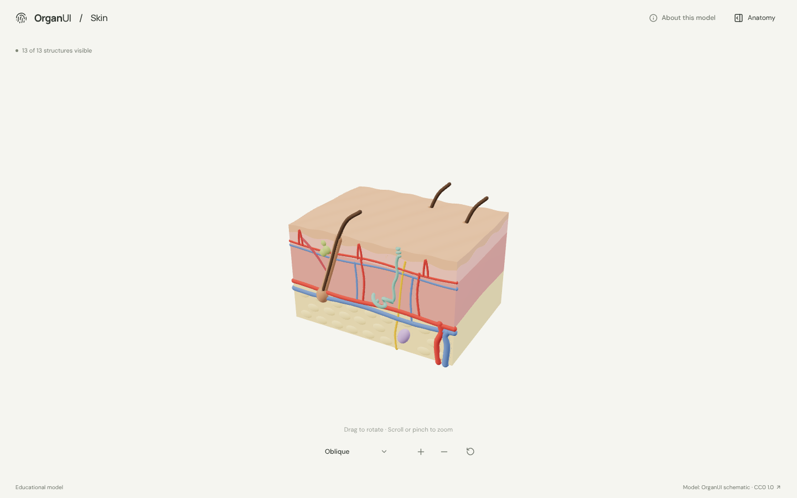
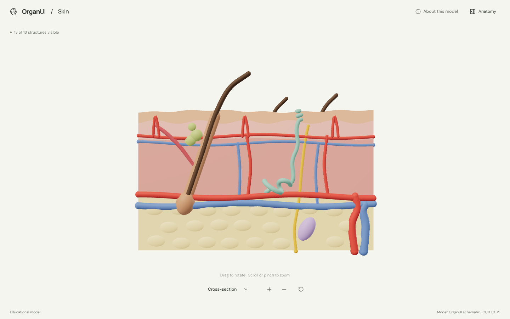
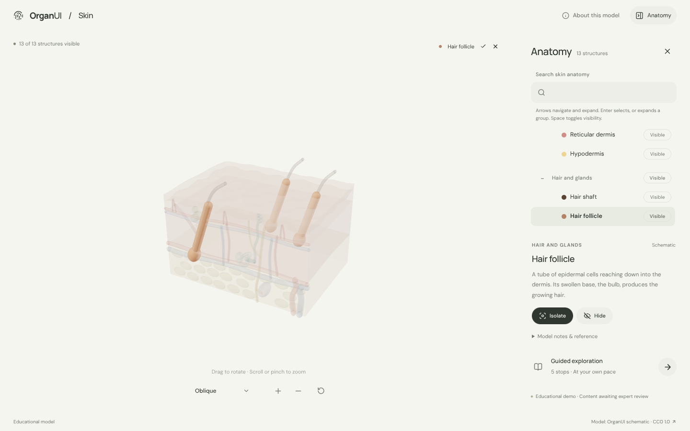
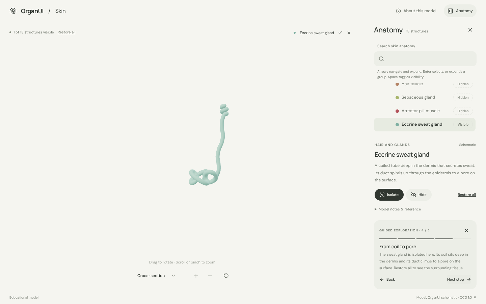
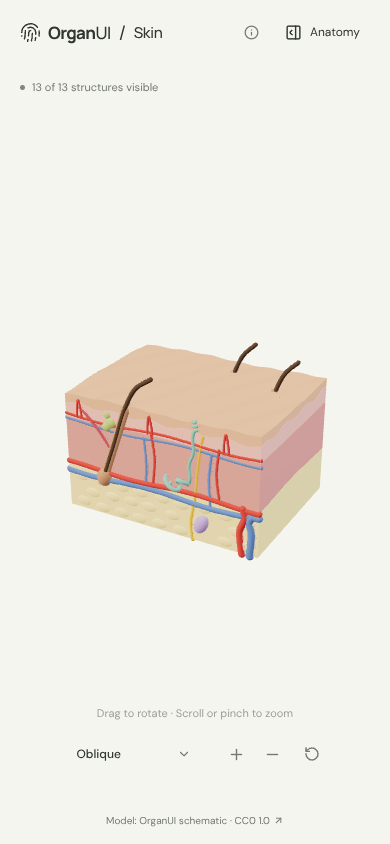
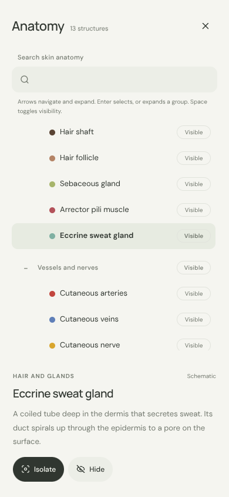

# OrganUI Skin

A minimal, standalone, open-source skin anatomy explorer built with React, TypeScript, Three.js, React Three Fiber, Vite, and Bun. It shows a layered cross-section of skin: epidermis, dermis, hypodermis, and their appendages.

**Status:** working local demo. Thirteen selectable structures in an original schematic model, responsive layouts, and desktop/mobile interactions checked in a browser. Public deployment and expert anatomy review have not been completed.



## Run locally

Install [Bun](https://bun.sh/) **1.4.2 or newer**, then:

```sh
git clone https://github.com/organui/skin-3d.git
cd skin-3d
bun install --frozen-lockfile
bun run dev
```

Open **http://127.0.0.1:5173**. No environment variables, accounts, API keys, sibling repositories, model downloads, or external font services are needed. The ready-to-use GLB is in `public/models/`.

```sh
bun run typecheck       # TypeScript checks, including the model generator
bun run test            # Unit tests for selection emphasis, picking, and the anatomy-tree adapter
bun run verify:model    # Check the GLB hash, structure IDs, and valid geometry
bun run build           # Typecheck and create dist/
bun run preview         # Serve the production build at http://127.0.0.1:4173
bun run format:check    # Check formatting
```

## Explore

The explorer follows the shared OrganUI explorer behaviour, with [heart-3d](https://github.com/organui/heart-3d) as the reference:

- The block opens in an **Oblique** view showing the surface and the cut face together. The view menu also offers **Cross-section** (straight at the cut face) and **Surface** (looking down onto the skin). Manual rotation changes the label to **Custom view**; zoom and selection do not.
- Toolbar order: view menu, zoom in, zoom out, reset.
- Select a structure in 3D or in the **Anatomy** panel (the OrganUI registry `anatomy-tree`). The selection glows in its own colour and everything else is ghosted, so follicles, glands and vessels inside the layers stay visible. A selection made in 3D shows a chip above the model; its name opens the panel.
- The panel is closed by default and opens from the header **Anatomy** button. Opening moves focus into it; Escape or close returns focus to the toggle. On phones it opens below the model.
- Isolate or hide a structure and restore all. **Reset explorer** restores the camera, visibility, selection, tree state, and tour.
- A five-stop guided exploration covers the epidermis, the papillary dermis, a hair follicle with its gland and muscle, the sweat gland (isolated), and the lamellar corpuscle.
- Keyboard: focus the model and use arrow keys to rotate, `+`/`-` to zoom. Reduced-motion preferences disable orbit damping.

<details>
<summary>Cross-section, selection, guided exploration, and mobile screenshots</summary>











</details>

## Model, credits, and review status

The skin model is **original schematic geometry generated by this repository** (`scripts/prepare-model.ts`) and is dedicated to the public domain under **[CC0 1.0](https://creativecommons.org/publicdomain/zero/1.0/)**. It uses no third-party anatomy data. BodyParts3D, used by the other explorers, has no layered skin. See [model provenance](docs/MODEL_PROVENANCE.md), [asset attribution](public/models/ATTRIBUTION.md), and the [manifest](public/models/manifest.json).

Known limitations:

- This is a schematic, not a measured model. The epidermis, vessels and glands are drawn much larger than in life so they stay legible.
- Epidermal strata, dermal fibres, apocrine glands, tactile corpuscles, free nerve endings and lymphatics are not modelled. Hairs, vessel plexuses and nerve branches are grouped into single selectable meshes.
- Descriptions are concise summaries of standard skin anatomy, linked to [NCI SEER Training](https://training.seer.cancer.gov/melanoma/anatomy/layers.html). **Expert anatomical review is pending.** This is an educational interface demonstration, not a diagnostic or treatment tool.
- Browser checks used headless Chromium at desktop and mobile viewport sizes, not physical devices or a screen-reader audit.

Fonts are bundled locally under the SIL Open Font License; see [third-party notices](public/licenses/README.md).

## Implementation

- `src/anatomy.ts`: structures, descriptions, views, and guided stops.
- `src/App.tsx`: selection/visibility state and accessible interface controls.
- `src/components/ui/anatomy-tree.tsx`: OrganUI registry component installed with the shadcn CLI; tracked unmodified. See [registry integration](docs/REGISTRY_INTEGRATION.md).
- `src/anatomy-adapter.ts`: tree data and visibility mapping for this scene.
- `src/Viewer.tsx`, `src/SceneCanvas.tsx`, `src/ViewMenu.tsx`, `src/picking.ts`: rendering, camera, and picking, shared in behaviour with the other explorers.
- `src/framing.ts`: identical across every OrganUI explorer; keep the copies in sync.
- `scripts/prepare-model.ts`, `scripts/verify-model.ts`: deterministic model generation and validation.

## License

Original application code: [MIT](LICENSE). Model: CC0 1.0. Fonts and icons retain their own licenses.

Part of [OrganUI](https://github.com/organui).
